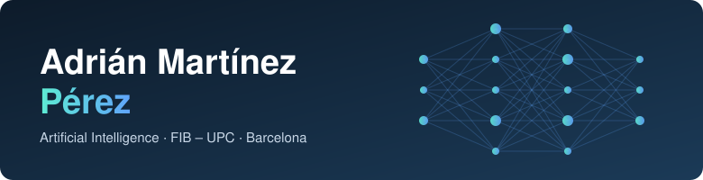
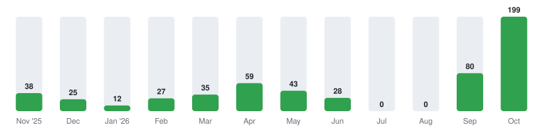
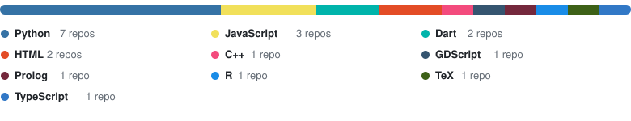

  

  

    
    
    
  

## 👋 About me

I'm a **third-year Artificial Intelligence student at [FIB – UPC](https://www.fib.upc.edu/en)** (Barcelona School of Informatics, Universitat Politècnica de Catalunya).

- 🎓 Studying the **Artificial Intelligence** degree at the Facultat d'Informàtica de Barcelona
- 🔭 Areas I work in: **AI and data analysis**, knowledge-based systems, optimization and control, mobile apps, web, 3D graphics and robotics
- 🔒 Most of what I build lives in **private repositories**, but the activity below counts it (aggregated, no details)
- 📫 Reach me on [LinkedIn](https://www.linkedin.com/in/adri%C3%A1n-mart%C3%ADnez-p%C3%A9rez-1254643b1/) or at [adrian.martinez.perez@estudiantat.upc.edu](mailto:adrian.martinez.perez@estudiantat.upc.edu)

## 🛠️ Tech I use

## 📈 Activity

<picture>
  <source media="(prefers-color-scheme: dark)" srcset="assets/stats-dark.svg">
  
</picture>

<picture>
  <source media="(prefers-color-scheme: dark)" srcset="assets/heatmap-dark.svg">
  
</picture>

**Contributions per month**

<picture>
  <source media="(prefers-color-scheme: dark)" srcset="assets/monthly-dark.svg">
  
</picture>

**Main language per repository**

<picture>
  <source media="(prefers-color-scheme: dark)" srcset="assets/languages-dark.svg">
  
</picture>

## 📂 Public repositories

| Repository | What it is |
| --- | --- |
| [adribetic-showcase](https://github.com/Adrifib/adribetic-showcase) | Flutter app to track pump infusion-set, CGM-sensor and battery changes, with reminders and stats · showcase of a private project · Dart |
| [BitsxLaMarato2025](https://github.com/Adrifib/BitsxLaMarato2025) | Bitsx la Marató 2025 · GDScript |
| [BitsxLaMarato](https://github.com/Adrifib/BitsxLaMarato) | Bitsx la Marató 2024 · Python |
| [pa1-practice](https://github.com/Adrifib/pa1-practice) | Three-in-a-row game · Python |
| [AdriCrypt](https://github.com/Adrifib/AdriCrypt) | A simple cryptography script · Python |

Charts are generated from the GitHub API by [a small script](scripts/generate.py) and refreshed daily by a GitHub Action. Contributions include private repositories, shown only as totals.
